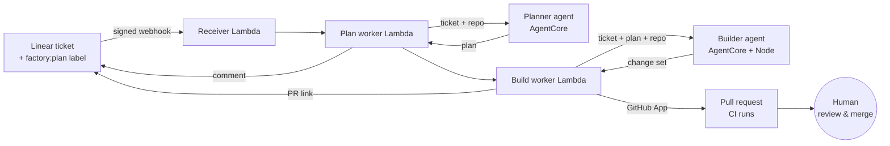

# software-factory

**Turn a Linear ticket into a tested GitHub pull request, with AI agents running on AWS and a human always making the final merge.**

Label a ticket `factory:plan`. About 25 seconds later an implementation plan is posted on the ticket. A minute or two after that, a pull request opens on the target repo. The pull request:

- is written by an AI builder agent
- was checked by the repo's own lint, typecheck, test and build
- comes from a GitHub App bot
- can't be merged until a person approves it

> 🎥 **Demo video:** _coming soon_

**See it in action** (real PRs opened by the factory on its sandbox repo):
- [factory-sandbox#2](https://github.com/Austin-Brock/factory-sandbox/pull/2): *"Add a dark mode toggle that persists between sessions"* (3 files, new tests, all checks green)
- [factory-sandbox#3](https://github.com/Austin-Brock/factory-sandbox/pull/3): *"Show the number of completed to-dos"* (ticket to PR in 59 seconds)

## How it works



1. **The receiver** checks Linear's HMAC signature and timestamp, ignores duplicate deliveries (DynamoDB), and answers within Linear's 5-second window.
2. **The planner agent** downloads a read-only snapshot of the repo and explores it with `list_files`, `read_file` and `search`. It then writes a plan that names the real files, and the plan is posted on the ticket.
3. **The builder agent** implements the plan in its own copy of the repo. It edits files through sandboxed tools and runs the repo's checks, fixing failures until they pass. It finishes by calling `finish(summary)`.
4. **The build worker** re-checks the change against the rules. It then commits on top of the exact commit the builder worked from and opens the PR, as a **draft** if checks failed. Finally it links the PR on the ticket.

## Safety and cost design

Agents that write code and run `npm install` are running untrusted code, so the design assumes the builder could be compromised:

| Concern | Control |
|---|---|
| Builder steals credentials | **The builder never holds GitHub credentials.** It only returns a change set, and only the build worker can read the GitHub App key. AWS credentials are removed from the npm environment. |
| Builder runs arbitrary commands | **No shell.** It can only run the repo's own `install`, `lint`, `typecheck`, `test` and `build` scripts. |
| Malicious or oversized changes | The build worker re-checks every change: no `.github/`, env or secrets files, safe paths only, ≤ 20 files / 200 KB, and no changes to `package.json` scripts (which could fake a passing check). |
| Bot merges its own code | The GitHub App has `contents` and `pull_requests` permissions only, with no `workflows` or admin access. Tokens are scoped to one repo. A `main` ruleset requires a human approval, and nothing in the code path merges. |
| Prompt injection via tickets or repo files | Ticket text is wrapped in `<ticket>` tags and treated as data, and so is repo content. Tools are locked to the snapshot, and only allowlisted repos can be downloaded. |
| Runaway agents | Tool-call, byte, check-run and time budgets. A hard `cancel()` stops a model that ignores them. Output tokens are capped. |
| Surprise AWS bills | Everything is pay-per-use (no VPC or NAT, nothing always on). There's a $10/month budget whose automatic action **denies Bedrock and AgentCore to every agent role** when it's hit. Logs are kept for 7 days. |

## Engineering notes

A few problems that only appeared in live testing, and how they were fixed:

- **Empty turns.** gpt-oss sometimes ends a turn with only internal reasoning, which once produced an empty plan. The agents now nudge it to continue, keeping their context, and never post an empty result.
- **Tool calls leaked as text.** The builder once wrote an `edit_file` call out as raw text in gpt-oss's internal format. The run "finished" early and opened a passing 2-line stub PR. The fix:
  - completion now requires an explicit `finish()` tool call
  - leaked calls are parsed and run through the same sandboxed tools
  - leaked text can never reach a PR

  In 12 live trials after the fix, all 12 builds finished and 2 leaks were recovered.
- **Webhook timing.** Linear allows 5 seconds, but a plan takes 15–30 s and a build up to 12 minutes. So: a fast receiver, an async plan worker, a separate 15-minute build worker, and no automatic retries, because a retry would bill a second run and open a duplicate PR.
- **Exact-commit PRs.** The builder records the commit SHA from the snapshot tarball's pax header, so the PR is based on precisely the code it read.

## Tech stack

Python 3.11 · [Strands Agents](https://strandsagents.com) · Amazon Bedrock (`openai.gpt-oss-120b`) · Bedrock AgentCore Runtime · AWS CDK (Python) · Lambda · DynamoDB · SSM Parameter Store · AWS Budgets · Linear (webhooks + GraphQL) · GitHub App (REST + Git Data API) · Docker (ARM64) · pytest

## Repository layout

| Path | Contents |
|---|---|
| `agents/planner.py`, `planner_service.py` | Planner agent and its AgentCore entrypoint |
| `agents/builder.py`, `builder_service.py`, `builder_tools.py` | Builder agent, entrypoint, and sandboxed edit and check tools |
| `agents/repo_tools.py` | Repo snapshot download plus read-only `list_files`, `read_file` and `search` with budgets |
| `integrations/linear/` | Webhook verification, Linear GraphQL client, receiver / plan worker / build worker handlers |
| `integrations/github/` | GitHub App auth, commit and PR creation, change rules |
| `infrastructure/` | CDK stack: both runtimes, the Lambdas, IAM, and the budget kill switch ([setup guide](infrastructure/README.md)) |
| `Dockerfile`, `Dockerfile.builder` | Planner image, and builder image with Node |
| `scripts/invoke_planner.py` | Call the deployed planner from the command line |
| `tests/`, `infrastructure/tests/` | 151 unit tests + 24 infrastructure template tests (all offline) |

## Running it yourself

You'll need an AWS account with Bedrock model access, a Linear workspace, and a GitHub App. Deployment, secrets and Linear/GitHub setup are covered step by step in **[infrastructure/README.md](infrastructure/README.md)**.

**Local development:**

```bash
python3.11 -m venv .venv && source .venv/bin/activate
pip install -r requirements-dev.txt
cp .env.example .env          # set AWS_PROFILE, BEDROCK_MODEL_ID
pytest                        # offline unit tests

# Plan a ticket against a public repo
PLANNER_REPO=Austin-Brock/factory-sandbox python -m agents.planner

# Run either agent as an AgentCore-compatible service on :8080
python -m agents.planner_service
python -m agents.builder_service
```

**Cost caps (`.env` / `cdk.json`):** `PLANNER_MAX_TOKENS` (default 4096) and `PLANNER_MAX_TICKET_CHARS` (default 20000). Per-plan and per-build tool budgets are set in `agents/`.

## Status and possible next steps

All five milestones are complete and deployed: local planner → AgentCore → Linear → repo-aware planning → builder with PRs.

Ideas for later:
- respond to PR review comments with follow-up commits
- support private repos (download snapshots with the App token)
- switch the builder to a stronger coding model
